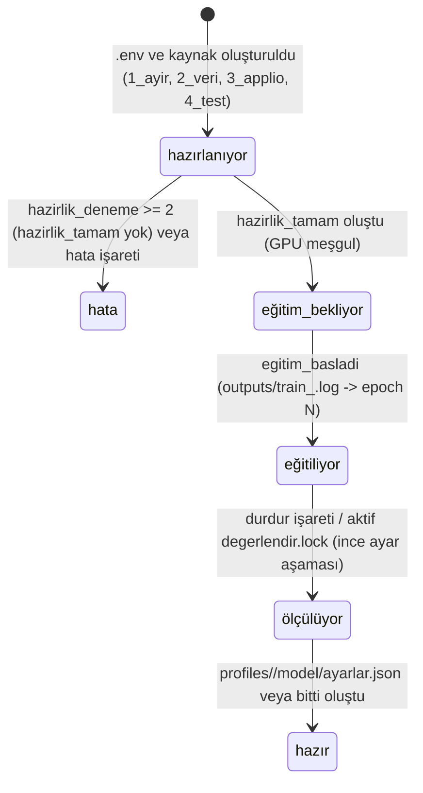

# Ses Stüdyosu — Uygulama Mimarisi (`docs/app/tasarim.md`)

Bu belge, `app/` altında yer alan **Ses Stüdyosu** Gradio uygulamasının katmanlı yapısını, profil durum makinesini ve dış süreç çalıştırıcı soyutlamasını özetler.

---

## 1. Katmanlı Mimari

Uygulama, arayüz kodunu (`app/ui.py`) dosya sistemi ve alt süreç yönetiminden ayırmak için beş modüle bölünmüştür:

| Katman / Dosya | Sorumluluk |
|---|---|
| `app/profiller.py` | `profiles/*/model/ayarlar.json`, `profiles/*/dataset/ozet.json`, `outputs/eval_*/sonuclar.csv` ve `outputs/.<profil>/` işaret dosyalarını okuyarak profilleri, hazır modelleri ve durumlarını listeler. |
| `app/yeni_ses.py` | Profil adı doğrulaması (`^[a-z][a-z0-9_]*$`), kaynak ses ve isteğe bağlı `.vtt`/`.txt` kopyalama, `scripts/profil/<profil>.env` + 20 cümlelik `<profil>_cumleler.txt` üretimi ve `Calistirici` üzerinden hattı başlatma. |
| `app/seslendir.py` | Türkçe metin normalizasyonu (`normalize_turkish_text`), ~250 karakter sınırına göre bölme (`split_text_for_xtts`), CPU'da `XTTSEngine` + `WhisperEngine` ile doğrulamalı sentez (`guvenli_sentezle`) ve ardından `RvcDonusturucu` ile hedef sese dönüştürme. Aynı anda tek sentez çalışması için `threading.Lock` kuyruğu içerir. |
| `app/donustur.py` | Seçilen profilin `ayarlar.json` parametreleriyle (`index_rate`, `protect`, `pitch`, `volume_envelope`) `scripts/eval/rvc_cevir.py` betiğini CPU modunda (`APPLIO_CONFIG_DIR=/tmp/applio_eval_config`) çalıştırır. |
| `app/ui.py` & `app/__main__.py` | 4 sekmeli (**Yeni Ses**, **Seslendir**, **Dönüştür**, **Modeller**) Gradio Blocks arayüzü, `gr.Timer(10.0)` ile 10 saniyede bir canlı durum yenileme ve `python -m app` (varsayılan `127.0.0.1:7860`) giriş noktası. |

---

## 2. Profil Durum Makinesi (`durum_cikar`)

`scripts/profil/kontrol.sh`, `hazirlik.sh`, `egitim.sh` ve `rvc_degerlendir.sh` betikleri durum geçişlerini `outputs/.<profil>/` altındaki işaret dosyalarıyla yönetir. `app/profiller.py` içindeki `durum_cikar(profil, kok_dizin)` fonksiyonu bu işaretleri aşağıdaki öncelik sırasıyla değerlendirir:

Durum çıktıları:
- `hazırlanıyor`: Veri hazırlığı (Demucs vokal ayırma, konuşmacı seçimi, Applio özellik çıkarma, XTTS taban testi) sürüyor.
- `eğitim bekliyor`: `hazirlik_tamam` mevcut ancak GPU başka bir eğitimde olduğu için RVC eğitimi sırasını bekliyor.
- `eğitiliyor (epoch N)`: `egitim_basladi` mevcut; son epoch numarası `outputs/train_<model>.log`, Applio checkpoint dosyaları veya `sonuclar.csv`'den okunur.
- `ölçülüyor`: Eğitim durma koşuluna (`durdur`) ulaştı ve `index_rate × protect` ince ayar taraması veya 10'luk checkpoint değerlendirmesi çalışıyor.
- `hazır`: `profiles/<profil>/model/ayarlar.json` (veya `bitti` işareti) mevcut; model **Seslendir** ve **Dönüştür** sekmelerinde kullanılabilir.
- `hata`: Hazırlık en az 2 kez başarısız oldu (`hazirlik_deneme >= 2`) veya açık `hata` işareti var.

---

## 3. Çalıştırıcı Arayüzü (`Calistirici`)

Testlerde veya geliştirme sırasında gerçek `systemctl` servislerini tetiklememek için `app/yeni_ses.py` içinde `Calistirici` protokolü tanımlanmıştır:

- **`SystemdCalistirici` (Üretim):**
  `systemctl --user enable --now rvc-profil@<profil>.timer` komutunu çalıştırır.
- **`SahteCalistirici` (Test):**
  Alt süreç başlatmaz; yalnızca başlatılan profil adlarını `baslatilanlar: list[str]` listesine kaydeder.

Benzer şekilde `Seslendirici` (`xtts`, `whisper`, `donusturucu`) ve `RvcDonusturucu` (`komut_calistirici`) bağımlılık enjeksiyonunu destekler; böylece birim testleri hiçbir modeli belleğe yüklemeden ve GPU/CPU tüketmeden saniyeler içinde çalışır.
